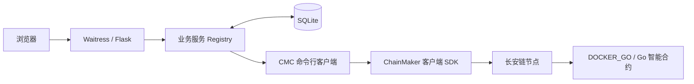

# 基于长安链的学历证书存证系统

**学链凭证（degree-cert-system）** 是一个面向高校签发、监管机构管理和查询机构核验的学历证书存证应用，采用 **Flask + SQLite + 长安链 ChainMaker + Go 智能合约** 实现。

系统将证书全文保存在链下，将证书内容摘要、有效状态和签发／撤销凭据保存在链上。通过浏览器即可完成证书签发、检索、内容核验、JSON 导出和监管撤销，适合区块链应用开发学习、案例讲解与本机演示。

本项目已在既有 Ubuntu 实验环境完成真实链上的合约部署与核心业务验收。仓库提供应用代码、合约、测试和配套脚本；**现有部署脚本仍绑定原实验环境，新电脑需要配置链、身份和部署参数，不能仅克隆仓库后直接启动完整系统。**

## 主要功能

| 功能       | 说明                                                         |
| ---------- | ------------------------------------------------------------ |
| 三角色登录 | 区分高校签发机构、监管机构和查询机构，提供相应工作台与操作权限 |
| 证书签发   | 校验并规范化证书内容，计算 SHA-256 摘要，通过 Go 合约完成存证；同一编号不可重复签发 |
| 多条件查询 | 支持完整证书编号、学生姓名、学校名称和学号查询；同名学生及同一学生的多张证书均可返回 |
| 分页与排序 | 每页 20 条，可按签发时间从早到晚或从晚到早排列               |
| 内容核验   | 重新计算证书摘要，与真实链上记录比较，同时检查是否已撤销     |
| JSON 导出  | 导出规范化证书正文，可将 JSON 文件用于后续内容核验           |
| 监管撤销   | 由监管机构撤销证书，保留原签发凭据，并记录撤销机构、原因、时间和交易 ID |
| 交易查证   | 记录待确认、已确认、失败等操作状态；结果不确定时查询原交易   |
| 操作追踪   | 保存本地交易记录与网页账号操作日志，辅助排查问题和演示业务流程 |
| 应用备份   | 提供 SQLite 快照及应用文件备份工具，便于保存实验成果         |

查询中的姓名、学校和学号采用完整匹配。查询机构未输入条件时显示查询入口；高校和监管机构还可浏览本地证书列表及使用综合关键词搜索。

**检索范围是本应用已登记到 SQLite 的证书**，并非扫描整条链上所有应用的数据。列表按本地保存的已确认链上签发时间排序，同一秒内按证书编号排序，未知签发时间的记录放在最后；证书详情与内容核验会实时读取链。

## 角色与权限

| 角色         | 演示账号     | 对应链上机构             | 主要权限                                     |
| ------------ | ------------ | ------------------------ | -------------------------------------------- |
| 高校签发机构 | `uni_admin`  | `wx-org1.chainmaker.org` | 签发、查询、核验与导出证书                   |
| 监管机构     | `edu_admin`  | `wx-org2.chainmaker.org` | 撤销、查询、核验与导出证书                   |
| 查询机构     | `query_user` | `wx-org3.chainmaker.org` | 按条件查询、核验与导出证书，无签发和撤销权限 |

网页端根据登录会话检查角色；合约端根据链认证的发送机构与 `CLIENT` 身份再次检查写权限。读取请求共用 org3 查询身份，签发和撤销分别使用 org1、org2 身份。链上私钥由服务端使用，不交给浏览器。

初始化时生成随机演示密码，保存在本机 `instance/demo-accounts.json`。仓库不提供通用默认密码。同一机构下的网页账号可以共用机构链身份，因此具体网页账号的操作由本地日志记录。

## 应用架构



- **展示层**：使用 Jinja 模板生成 HTML，配合本地 CSS 和 JavaScript；无需 Node.js 构建或独立前端服务。
- **应用层**：Flask 处理登录、会话、表单和角色校验；业务服务负责数据规范化、查询、交易登记及结果确认。
- **链访问层**：Python 通过 CMC 调用链，CMC 内部使用 ChainMaker 客户端 SDK；浏览器不直接连接链节点。
- **合约层**：Go 合约负责权限校验、证书存证、内容摘要比较和撤销状态维护，通过长安链合约 SDK 读写链状态。

当前使用链 ID `chain1`、合约名 `degree_cert_v1`、合约版本 `1.0`，数据协议为 `degree-cert/v1`。

## 链上与链下数据设计

| 存储位置    | 保存内容                                                     | 作用                                                     |
| ----------- | ------------------------------------------------------------ | -------------------------------------------------------- |
| 链上合约    | 证书编号、内容摘要、有效／撤销状态，签发与撤销机构、交易 ID、时间、撤销原因 | 提供内容比对和状态查询依据，保留签发与撤销凭据           |
| 链下 SQLite | 证书全文，账号、口令哈希、角色，操作状态、回执缓存与审计日志 | 支持页面展示、多条件检索、导出、摘要重算、登录和操作恢复 |

证书以 `cert_id` 为唯一标识，`student_id` 仅作为查询索引，因此同一学生可以保存多张学历证书。规范化证书正文包含：

```text
schema_version、cert_id、student_id、student_name、school_name、major、degree、graduation_date
```

摘要计算过程：字段校验 → 去除文本首尾空白并进行 Unicode NFC 规范化 → 按键排序生成紧凑 JSON → UTF-8 编码 → SHA-256。

核验分别回答两个问题：**内容是否与存证一致，以及证书当前是否有效**。已撤销证书仍可显示“内容一致”，但不能判定为有效。摘要一致也不等于学历事实已经得到证明，原始信息的审核仍由签发机构负责。链上摘要不能还原证书全文，因此需要保留链下数据备份。

## 交易确认机制

签发和撤销会先在 SQLite 中保存请求标识、证书数据、链参数和交易 ID，再提交链上交易。CMC 返回响应后，系统继续按原交易 ID 查询已入块交易，核对链、合约、方法、参数、发送机构和合约执行结果，通过后才标记业务成功。

网络超时或回执不足时，操作保持“待确认”；合约明确拒绝时，记录为失败。“查证原交易”只查询已登记交易，不重新发送签发或撤销请求。这样可以避免把调用超时误判为签发失败后再次提交。

SQLite 与链之间没有统一数据库事务；该机制用于追踪和核对跨系统操作，不代表已实现分布式原子提交。

## 代码结构与阅读入口

```text
degree-cert-system/
├── backend/
│   ├── app.py                    # init / doctor / serve 命令入口
│   ├── degreeapp/
│   │   ├── __init__.py            # Flask 路由、登录、CSRF 与角色校验
│   │   ├── domain.py              # 字段校验、规范 JSON 与 SHA-256
│   │   ├── service.py             # 查询、签发、撤销与交易查证
│   │   ├── chain.py               # CMC 调用、机构身份与回执核对
│   │   ├── db.py                  # SQLite 表结构与数据访问
│   │   ├── templates/            # Jinja 页面
│   │   └── static/               # 本地 CSS 与 JavaScript
│   ├── tests/                    # 应用与链调用边界测试
│   ├── requirements-linux.lock   # Linux 离线依赖与哈希锁定
│   └── wheels/                   # Python 离线依赖包
├── contracts/degreecert/
│   ├── main.go                   # Go 合约入口与 SDK 适配
│   ├── core/                     # 业务规则与核心测试
│   └── vendor/                   # Go 离线构建依赖
├── config/                       # CMC / SDK 配置
├── scripts/                      # 环境检查、构建部署、运行与备份脚本
├── docs/                         # 分步说明与设计文档
├── instance/                     # 本机身份、部署记录、账号与数据库（运行时生成）
└── reports/                      # 本机检查报告（运行时生成）
```

建议从 [domain.py](backend/degreeapp/domain.py) 理解证书格式与摘要，再阅读 [service.py](backend/degreeapp/service.py) 的业务流程、[chain.py](backend/degreeapp/chain.py) 的链调用，最后对照 [Go 合约核心](contracts/degreecert/core/core.go) 理解链上规则。

合约主要方法如下：

| 方法                | 用途                               |
| ------------------- | ---------------------------------- |
| `health`            | 读取合约初始化状态、协议与机构配置 |
| `issueCertificate`  | 高校机构签发证书                   |
| `getCertificate`    | 按编号读取链上证书记录             |
| `verifyCertificate` | 比较内容摘要并返回有效／撤销状态   |
| `revokeCertificate` | 监管机构撤销证书                   |

## 运行环境

以下是当前项目验证使用的环境，而非所有版本的兼容性承诺。

| 组件              | 当前实验配置                                                |
| ----------------- | ----------------------------------------------------------- |
| 操作系统          | Ubuntu 24.04.3 LTS，x86_64                                  |
| 虚拟机内存        | 8 GB                                                        |
| Python            | 3.12.3，项目内 `.venv`                                      |
| Web 服务          | Flask 3.1.3、Waitress 3.0.2                                 |
| 数据库            | SQLite                                                      |
| Go                | 1.18.10                                                     |
| 长安链            | 2.4.0 系列实验环境；既有四节点发布目录标记为 `v2.4.0_alpha` |
| CMC / Go 合约 SDK | 2.4.0                                                       |
| 合约运行时        | `DOCKER_GO`，依赖 Docker 与对应 VM 引擎                     |
| 其他工具          | Git、OpenSSL、7z 等                                         |

仓库中的 Python 离线包面向 **Linux x86_64 / CPython 3.12**。教学环境若采用 ChainMaker 2.3.4，需要另行核对节点、CMC、合约 SDK 与运行时兼容性；本仓库尚未完成该版本的迁移验收。

## 获取代码与首次部署

```bash
git clone https://github.com/sager7723/degree-cert-system.git
cd degree-cert-system
```

仓库保留了原实验环境的分步脚本，可用于理解部署流程：

| 阶段       | 入口                                                         | 主要工作                                                     |
| ---------- | ------------------------------------------------------------ | ------------------------------------------------------------ |
| 环境检查   | `scripts/01-check-environment.sh`、`scripts/02-check-chain.sh` | 检查工具、链目录与配置                                       |
| 节点启动   | `scripts/03-start-and-query.sh`                              | 启动或检查已有四节点，查询真实区块                           |
| 身份与构建 | `scripts/04-prepare-development.sh`                          | 准备应用身份，执行 Go 核心测试，编译 Linux 合约并打包为 7z   |
| 部署与验收 | `scripts/05-deploy-and-verify.sh`                            | 通过 CMC 创建合约，验证签发、核验、撤销及越权拒绝            |
| 网页安装   | `scripts/06-install-web.sh`                                  | 向已有虚拟环境安装依赖，初始化 SQLite 与账号，检查真实链连接 |
| 网页启动   | `scripts/07-start-web.sh`                                    | 启动 Waitress 服务                                           |
| 应用备份   | `scripts/08-backup-application.sh`                           | 保存应用文件和数据库快照                                     |

**新环境不能直接照编号依次执行全部脚本。** 当前脚本以 `/home/wsc/degree-cert-system`、`/home/wsc/chainmaker-go` 和已有机构证书为基础；部分脚本还检查用户名 `wsc`。部署流程保存了原构建产物的 SHA-256 和特定验收恢复记录，换环境或重新构建后需要重新审查并适配。

首次移植应完成以下准备：

1. 部署可用的长安链节点及 `DOCKER_GO` 引擎，确认 CMC 能查询区块。
2. 按自己的链配置准备机构证书、密钥、节点地址与信任根，适配角色对应的 SDK 配置和 CMC 路径。
3. 测试、编译并部署 Go 合约，完成真实业务验收，保留实际生成的 `instance/chain-deployment.json` 和 `instance/stage05-state.json`。现有网页初始化还依赖第五步状态中的两份演示证书，并会查询链核对摘要；迁移时需一并适配此初始化流程，不要仅手工填写验收标记来跳过验证。
4. 准备 Python 3.12 虚拟环境，安装依赖，初始化网页数据并执行 `doctor` 检查，然后启动网页。

节点账本、Docker 镜像、CMC 二进制、私钥、数据库和运行时部署记录不随本仓库分发。`docs/` 保留了重建时的分步记录，其中 ZIP 文件名和个人目录属于当时环境，迁移时需要结合当前代码调整。

## 已部署环境的日常启动

以下命令适用于已经完成合约与网页安装的原 Ubuntu 环境。重启电脑后，无需重新编译或部署合约。

先启动并检查节点：

```bash
cd /home/wsc/degree-cert-system
sudo -v
bash scripts/03-start-and-query.sh
```

确认脚本成功且真实区块查询通过后，检查应用连接：

```bash
.venv/bin/python -B backend/app.py doctor
```

确认 `doctor` 显示真实合约可用后，再启动网页：

```bash
bash scripts/07-start-web.sh
```

在 **Ubuntu 浏览器**访问 [http://127.0.0.1:8080](http://127.0.0.1:8080)。网页默认只监听本机回环地址，Windows 主机的 `127.0.0.1` 不指向 Ubuntu 虚拟机。

保持启动终端运行，按 `Ctrl+C` 只停止网页服务，链节点继续运行。网页服务以普通用户运行，不要使用 `sudo bash scripts/07-start-web.sh`。如果检查失败，先查看对应报告；不要通过重新部署合约或反复提交交易来恢复网页。

## 测试与演示

在已安装项目 Python 依赖的环境中，从仓库根目录运行离线测试：

```bash
.venv/bin/python -B -m unittest discover -s backend/tests -p 'test_*.py'
.venv/bin/python -B -m unittest discover -s scripts -p 'test_*.py'
```

Go 合约核心测试使用仓库内的 `vendor` 依赖：

```bash
cd contracts/degreecert
GOPROXY=off go test -mod=vendor -p 1 ./core
```

这些测试使用临时数据及测试替身检查业务规则、权限、查询排序、回执解析和异常恢复，不会向真实链发送交易，也不能代替真实节点上的部署验收。

推荐使用虚构信息演示以下闭环：

1. 高校机构签发证书，查看证书编号、摘要与签发交易 ID。
2. 查询机构按编号、姓名或学校检索，验证同名学生和一人多证的查询结果。
3. 导出 JSON 并核验原文件，观察内容一致、证书有效的结果。
4. 修改导出文件中的姓名或专业后再核验，观察摘要不一致。
5. 监管机构撤销该证书，填写撤销原因。
6. 再次核验原文件，观察“内容一致、证书已撤销”，并查看原签发与撤销凭据。

遇到“交易结果尚待确认”时，应在交易记录中查证原交易；“暂无法核验”表示当前未取得有效链响应，不等于证书伪造或已经撤销。

## 相关文档

- [应用架构、数据设计与代码入口](docs/10-application-design.md)
- [合约部署与真实业务验收](docs/07-step05-deploy-and-verify.md)
- [网页安装与浏览器验收](docs/09-step06-web-system.md)
- [多条件查询、排序与分页](docs/15-step06-search-upgrade.md)
- [应用备份与重启恢复](docs/13-step07-backup-and-restart.md)
- [录屏与演示流程](docs/14-recording-rehearsal.md)

## 可扩展方向

- **隐私与身份**：按核验目的进行选择性披露，完善机构密钥管理、轮换与账号授权。
- **数据与一致性**：增加证书更正及版本关联，建立链下检索索引与链上状态的定期对账机制。
- **部署与运维**：将个人路径改为可配置参数，提供可移植的初始化流程、监控和更完整的备份恢复方案。
- **业务场景**：拓展至职业资格、培训学分、实习实践认证和科研过程存证，并按场景重新设计字段与权限。

以上为后续方向。当前版本聚焦本机教学演示，尚未提供批量签发、证书版本管理、PDF 附件存储和面向公网的生产部署方案。本地操作日志也不等同于不可修改的链上审计记录。

运行时身份密钥、随机密码、数据库和应用备份应保留在自己的受控环境中。应用备份包含身份与账号数据，但不包含链节点账本，不能单独恢复整套区块链环境。
